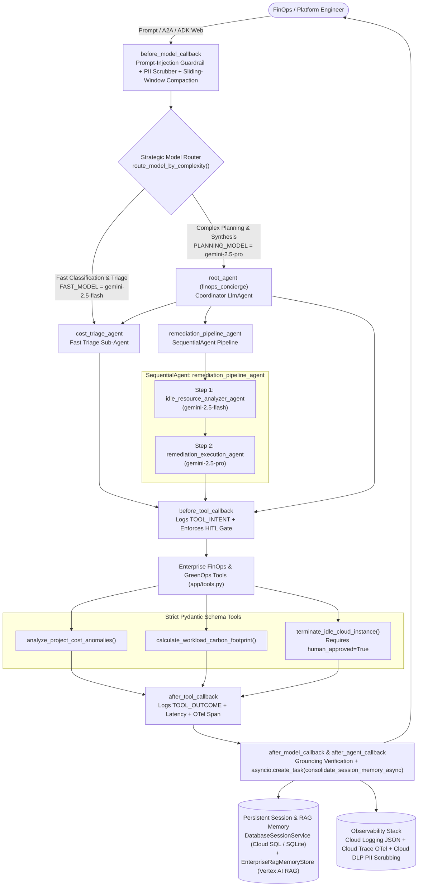

# Enterprise Cloud FinOps & Sustainability Concierge Agent

An enterprise-grade multi-agent system built with the **Google Agent Development Kit (ADK)** and scaffolded with **`google-agents-cli` / Agent Starter Pack**. The agent helps Platform Engineering, FinOps, and Sustainability (GreenOps) teams detect anomalous cloud spend, quantify Scope 2 & Scope 3 regional carbon emissions, recommend 24/7 Carbon-Free Energy (CFE) workload migrations, and safely remediate idle Compute Engine resources behind a mandatory **Human-in-the-Loop (HITL)** governance gate.

---

## 1. Problem Statement

Enterprise cloud environments frequently suffer from two interconnected challenges:
1. **Unchecked Cloud Spend Spikes**: Forgotten GPU/CPU batch instances, unpartitioned BigQuery scans, and over-provisioned clusters silently drive 20–50%+ budget overruns.
2. **Opaque Workload Carbon Footprints**: Engineering teams lack actionable visibility into how regional grid carbon intensity (`gCO2eq/kWh`) and Power Usage Effectiveness (PUE) affect Scope 2 operational and Scope 3 embodied hardware emissions—and how migrating batch workloads to high-CFE Google Cloud regions (such as `us-central1` or `europe-north1`) can simultaneously reduce cost and carbon emissions.

At the same time, autonomous infrastructure remediation carries operational risk: **an AI agent must never terminate production or staging compute instances without explicit human confirmation, full PII redaction, and auditable intent-vs-outcome telemetry.**

---

## 2. System Architecture



---

## 3. Production Engineering Criteria Matrix (19/19 Implemented)

| Category | Criterion | Implementation Evidence |
| :--- | :--- | :--- |
| **1. Tool & Interface Design** | Descriptive Naming | `analyze_project_cost_anomalies`, `calculate_workload_carbon_footprint`, `terminate_idle_cloud_instance` in `app/tools.py` |
| | Explicit JSON Schemas | Strict Pydantic `BaseModel` schemas (`CostAnomalyInput`, `CostAnomalyOutput`, `CarbonFootprintInput`, `CarbonFootprintOutput`, `TerminateInstanceInput`, `TerminateInstanceOutput`) with `Field(...)` constraints in `app/tools.py` |
| | Comprehensive Docstrings | Detailed Google-style docstrings (`Args:`, `Returns:`, `Raises:`) on every tool in `app/tools.py` |
| | Guided Error Handling | `try/except` blocks catching `ValidationError` and runtime errors, returning `{"status": "error", "recovery_instructions": ...}` in `app/tools.py` |
| **2. Context & Memory** | Robust System Instructions | `SYSTEM_CONSTITUTION` in `app/memory.py` defining FinOps thresholds (`>15%` variance), 24/7 CFE sustainability rules, and HITL safety constraints |
| | History Compaction | `compact_conversation_history()`, `get_events_compaction_config()` (`EventsCompactionConfig`), and `get_context_cache_config()` (`ContextCacheConfig`) in `app/memory.py` |
| | Persistent Session State | `create_persistent_session_service()` (`DatabaseSessionService` with SQLite/Cloud SQL URL) + `EnterpriseRagMemoryStore` (`VertexAiRagMemoryService` with local vector fallback) in `app/memory.py` |
| | Async Memory Operations | `async def consolidate_session_memory_async(session_id, transcript)` scheduled non-blockingly via `asyncio.create_task()` in `app/memory.py` & `app/callbacks.py` |
| **3. Orchestration & Logic** | Multi-Agent Patterns | `root_agent` (`LlmAgent` coordinator), `cost_triage_agent` (`LlmAgent`), and `remediation_pipeline_agent` (`SequentialAgent` chaining `idle_resource_analyzer_agent` -> `remediation_execution_agent`) in `app/agent.py` |
| | Strategic Model Routing | `FAST_MODEL = "gemini-2.5-flash"`, `PLANNING_MODEL = "gemini-2.5-pro"`, and `route_model_by_complexity()` in `app/config.py`, `app/callbacks.py`, and `app/agent.py` |
| | Guardrails & Policy Plugins | `before_model_callback` (prompt-injection blocker + PII scrubber), `after_model_callback` (grounding verification), and `FinOpsGuardrailPlugin` in `app/callbacks.py` |
| | Human-in-the-Loop Hooks | Mandatory HITL gate (`tool_context.actions.require_confirmation` & `human_approved: bool = False` check) in both `terminate_idle_cloud_instance` (`app/tools.py`) and `before_tool_callback` (`app/callbacks.py`) |
| **4. Observability & Tracing** | Structured JSON Logging | `google.cloud.logging` + `python-json-logger` (`FinOpsJsonFormatter`) emitting `session_id`, `agent_name`, `severity`, and `event_type` with **zero `print()` statements** in `app/telemetry.py` |
| | Intent vs. Outcome Capture | Explicit `"event_type": "TOOL_INTENT"` in `before_tool_callback` and `"event_type": "TOOL_OUTCOME"` (with `latency_ms`) in `after_tool_callback` in `app/callbacks.py` |
| | Distributed Tracing | OpenTelemetry `TracerProvider`, `BatchSpanProcessor`, `CloudTraceSpanExporter` (with local buffer/console fallback), and `trace_span()` in `app/telemetry.py` |
| | PII Redaction | `scrub_pii_data(text)` using regex + optional `google.cloud.dlp_v2` (`DlpServiceClient`) redacting emails, phone numbers, credit cards, SSNs, and API keys in `app/telemetry.py` |
| **5. Infrastructure & CI/CD** | Secure Secret Management | `get_secret(secret_id)` in `app/config.py` using `SecretManagerServiceClient` with environment variable fallback and zero hardcoded credentials |
| | Infrastructure as Code | `deployment/terraform/main.tf` (plus `deployment/terraform/single-project/`) provisioning Cloud Run v2, Vertex AI & DLP APIs, Secret Manager secrets, Cloud SQL, and Cloud Logging/Trace IAM roles |
| | Automated Evaluation Suites | `tests/eval/golden_dataset.evalset.json` and `tests/test_agent_eval.py` using `pytest` and ADK's `AgentEvaluator` |

---

## 4. Scaffolding & Development Commands (`agents-cli` / `agent-starter-pack`)

### Preload Official ADK Skills & Scaffold Project
```bash
# Install / setup official ADK coding agent skills
uvx google-agents-cli setup

# Scaffold the ADK project with Terraform, Cloud Run, GitHub Actions CI/CD, Cloud SQL sessions & Evals
uvx google-agents-cli scaffold create finops-concierge \
  --agent adk \
  --deployment-target cloud_run \
  --cicd-runner github_actions \
  --session-type cloud_sql \
  --bq-analytics

# Equivalent Agent Starter Pack command
uvx agent-starter-pack create finops-concierge -a adk -d cloud_run --cicd-runner github_actions
```

### Install Dependencies & Run Locally
```bash
# Install dependencies including evaluation and linting extras
uv sync --extra eval --extra lint

# Launch the interactive ADK Web UI locally (runs out-of-the-box)
uv run adk web . --port 8501

# Or launch the FastAPI + A2A production server locally
uv run uvicorn app.fast_api_app:app --host 0.0.0.0 --port 8000
```

---

## 5. Automated Testing & ADK Golden Dataset Evaluation

```bash
# Run the full unit, integration, and ADK AgentEvaluator golden dataset test suite
uv run pytest tests/unit/test_dummy.py tests/integration/test_agent.py tests/test_agent_eval.py -v

# Run ADK CLI evaluation directly against the golden dataset
uv run adk eval app tests/eval/golden_dataset.evalset.json --config_file_path=tests/eval/test_config.json --print_detailed_results
```

---

## 6. Cloud Deployment (Terraform & Cloud Run)

### Option A: Automated Deployment via `agents-cli`
```bash
# Authenticate to your Argolis / Google Cloud project
gcloud auth login
gcloud auth application-default login
gcloud config set project YOUR_GCP_PROJECT_ID

# Deploy agent container and infrastructure to Cloud Run
uvx google-agents-cli deploy --project YOUR_GCP_PROJECT_ID --region us-central1
```

### Option B: Infrastructure Provisioning via Terraform (`deployment/terraform/main.tf`)
```bash
cd deployment/terraform
terraform init
terraform plan -var="project_id=YOUR_GCP_PROJECT_ID" -var="region=us-central1"
terraform apply -var="project_id=YOUR_GCP_PROJECT_ID" -var="region=us-central1"
```
